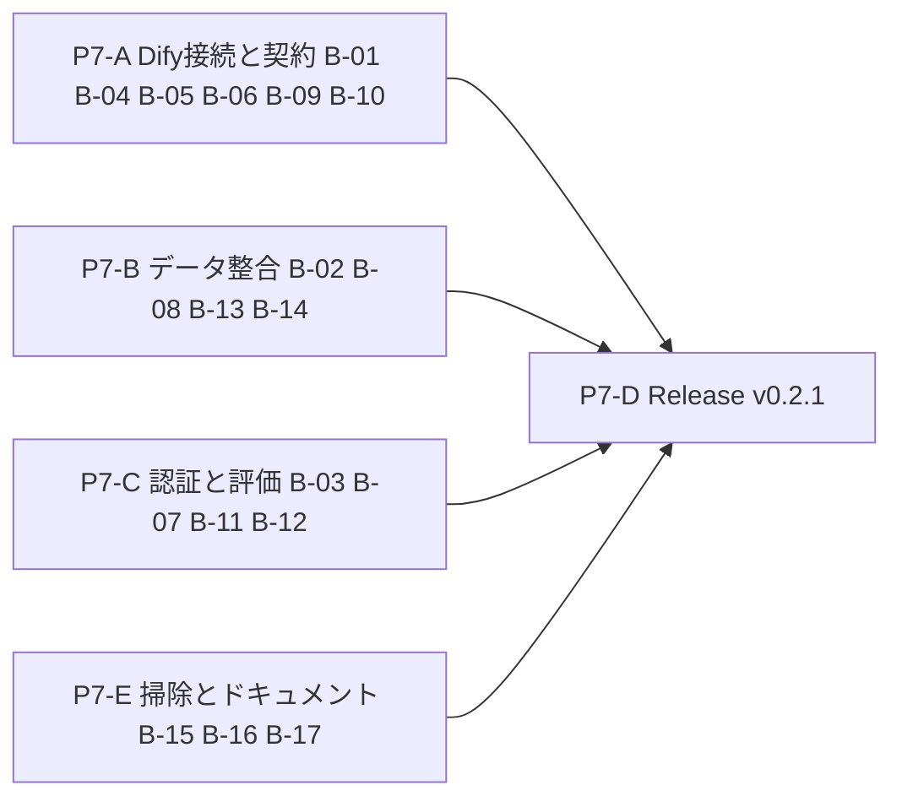

# 22 DB2RAG v0.2.1 再監査・欠陥一覧・修正設計・Phase 7 Grok 実装指示書

| 項目 | 内容 |
|---|---|
| **目的** | `v0.2.0` リリース後のコード・Dify 契約・運用実測に基づき、**実運用ブロッカーとデータ欠損リスク**を特定し、`v0.2.1` 向けの Phase 7 実装仕様（Plan 01〜06）を Grok ワーカー向けに固定する |
| **対象読者** | マスター（承認・優先順位）、Architect（管理レビュー）、Grok ワーカー（Phase 7-A〜E） |
| **作成日** | 2026-11-24 |
| **対象バージョン** | `v0.2.0`（commits `5eab933`, `46bee74`）→ **`v0.2.1`** |
| **この文書が決めること** | 欠陥 ID（B-01〜B-17）、重要度、根拠コード、修正アルゴリズム、Phase 7 分割、テスト・受入条件 |
| **この文書が決めないこと** | `H:\CURSOR\dify/**` の改修、Ruri モデル変更、チャット UI 新設 |

---

## 0. 開発ブリーフ（6 項目）

| # | 項目 | 内容 |
|---|---|---|
| 1 | **目的** | Dify 外部知識として**実際に検索できる状態**にし、MySQL 増分同期の**行欠損をゼロ**にし、LAN / eval / export の**誤動作・セキュリティ穴**を塞ぐ |
| 2 | **repo 構成** | `H:\CURSOR\DB2RAG`（Python 3.11+ / FastAPI / SQLite WAL / Qdrant 1.19 / `cl-nagoya/ruri-v3-310m` FP32 / `web/` / `tests/` / `TEST.py`） |
| 3 | **変更範囲** | **触ってよい**: `src/db2rag/**`, `web/**`, `tests/**`, `TEST.py`, `scripts/**`, `testdata/**`, `pyproject.toml`, `CHANGELOG.md`, `README.md`, `docs/**`（本書・`14`・`09`・`17`・`18` 追記）<br>**触らない**: `H:\CURSOR\dify/**`（参照のみ）、Ruri ID・revision・768 次元・`PREFIX_DOC` / `PREFIX_QUERY` |
| 4 | **完了条件** | ① Dify 登録後、コンテナ経由で `POST .../dify/retrieval` が 200 で `records` を返す（SSRF 許可手順ドキュメント化・UI 案内含む）<br>② 増分 MySQL ジョブ中断再開で行が欠損しない（単体テストで再現・修正）<br>③ LAN bind + `DB2RAG_API_KEY` 時、bundled UI が API を利用できる<br>④ Dify `score_threshold` が返却 `score`（RRF）に対して意味を持つ<br>⑤ eval Gate が「常時赤」にならないベースライン設計 + `TEST.py` が Qdrant 二重ロックしない<br>⑥ `export` が `is_latest=0` を含まない<br>⑦ `uv run pytest` / ruff / mypy / `scripts/run-user-story-tests.py` / `TEST.py` pass、`version` **0.2.1** |
| 5 | **テスト** | Phase 完了ごと: `uv run ruff check src tests`, `uv run mypy src`, `uv run pytest -q`。統合: `uv run python TEST.py --skip-docker --hash-embed`、可能なら `uv run python TEST.py` |
| 6 | **優先順位** | **品質（データ安全・Dify 接続）> 保守性 > 速度** |

### 役割分担

| 役割 | 担当 | 責務 |
|---|---|---|
| **Architect** | claude-opus-5-5-high | 各 Phase マージ前の管理レビュー（§6 チェックリスト）、バグ調査 |
| **Builder** | grok-4.7-high | Phase 7-A〜E の実装（1 Phase = 1 ブランチ、計画外の発明禁止） |
| **人間（マスター）** | プロダクトオーナー | Dify SSRF 許可の実環境確認、`host.docker.internal` と 127.0.0.1 bind の到達性 [要検証] |

---

## 1. v0.2.0 完了判定と残ギャップ

### 1.1 完了していること（v0.2.0 スコープ）

| 項目 | 状態 |
|---|---|
| Phase 0〜6（設計書 `21`）の実装 | **完了**（main に push 済み） |
| 単体・lint・型 | pytest 49 pass、ruff / mypy clean（2026-11-23 時点） |
| All_Status | 10 pass / 0 fail |
| Dify エンドポイント実装 | `POST /api/v1/dify/retrieval`、403/404 コード、Bearer |

### 1.2 再監査結論（v0.2.1 が必要な理由）

**総合**: コード上は「Dify 契約を満たす API」は存在するが、**Dify 側 SSRF プロキシ設定なしでは到達不能**であり、MySQL 増分同期は**ジョブ失敗時に行を永久欠損**しうる。LAN 公開時は bundled UI が**認証なしで全 API を叩けず**使えない。評価 Gate は現ベースライン設計では**実質常時不合格**。

---

## 2. Plan 01: 要件整理 — 欠陥カタログ（B-01〜B-17）

重要度: **P0** = Dify 接続不能・データ欠損 / **P1** = 誤動作・セキュリティ / **P2** = テスト・保守。

### P0

#### B-01 Dify SSRF プロキシが DB2RAG エンドポイントを遮断

| 項目 | 内容 |
|---|---|
| **重要度** | P0 |
| **症状** | Dify で外部知識 API を登録しても retrieval が失敗。エラー例: `Access to '...' was blocked by SSRF protection` |
| **根拠** | `H:\CURSOR\dify\docker\ssrf_proxy\squid.conf.template`: `http_access deny to_private_networks`（private / loopback 宛拒否）<br>`dify/api/core/helper/ssrf_proxy.py` L241–263: Squid 拒否を `ToolSSRFError` で返す<br>`dify/docker/.env`: `SSRF_PROXY_ALLOW_PRIVATE_IPS=` 空、`SSRF_PROXY_ALLOW_PRIVATE_DOMAINS` 未設定<br>DB2RAG `dify-config` は `http://host.docker.internal:{port}/api/v1/dify` を案内（`api.py` L437–439） |
| **方針** | **Dify リポジトリは編集しない**。運用手順と UI でマスターが Dify 側 `.env` を更新する |
| **修正設計** | 1. README / `docs/14_local_ai_integration.md` に「必須 Dify 設定」節を追加:<br>&nbsp;&nbsp;- `SSRF_PROXY_ALLOW_PRIVATE_DOMAINS=host.docker.internal`（必要なら `SSRF_PROXY_ALLOW_PRIVATE_IPS` にホスト LAN CIDR）<br>&nbsp;&nbsp;- `docker compose restart ssrf_proxy`（または middleware スタック全体）<br>2. `GET /api/v1/rags/{id}/dify-config` レスポンスに `dify_ssrf_env_hint` オブジェクト（`variable`, `example_value`, `restart_note`）を追加<br>3. `web/index.html` Dify ダイアログに SSRF 設定のコピー行とトラブルシュート表（症状 → 原因 → 対処）<br>4. `TEST.py`: Docker 利用可能時、`docker run --rm curlimages/curl` 等で `host.docker.internal:{port}` へ probe（`knowledge_id=""` の 200）。不可なら `skip` で記録<br>5. マスター検証項目 [要検証]: API が `127.0.0.1` bind のみのとき `host.docker.internal` から到達するか（OS / Docker Desktop 依存） |
| **変更ファイル** | `api.py`, `web/index.html`, `web/live.js`, `README.md`, `docs/14_local_ai_integration.md`, `TEST.py`, `tests/test_phase5_dify.py`（`dify-config` 新フィールド） |

#### B-02 MySQL 増分同期のカーソルが行欠損を起こす

| 項目 | 内容 |
|---|---|
| **重要度** | P0 |
| **症状** | 増分列ありの初回全件取込でジョブが途中失敗すると、未読行の `updated_at` がカーソルより小さく、次回 `> cursor` で**永久スキップ** |
| **根拠** | `mysql_reader.py` L267–269: `ORDER BY` は **WHERE（増分）があるときのみ**付与。初回全件は順序不定<br>`pipeline.py` L610–612: **バッチごと**に `sync_cursor` を commit（オブジェクト完了前）<br>`mysql_reader.py` L269: 比較は **`>` のみ**（同タイムスタンプ行の取りこぼし） |
| **修正設計** | 1. `updated_at_column` が設定されているオブジェクトは、**初回含め常に** `ORDER BY base.{updated_at}, base.{pk...}` を付与（PK は `_mysql_pk` と整合）<br>2. 増分 WHERE を `>= %s` に変更し、取込側 `row_hash` / `content_hash` で既存行をスキップ（重複 ingest は idempotent のまま）<br>3. `_write_sync_cursor` は **オブジェクト単位の全バッチ成功後**（`_process_mysql_item` の finally 直前、または job_item `done` 時）のみ呼ぶ。途中失敗時はカーソルを進めない<br>4. `_later_cursor` はバッチ内 max のみ保持し、commit は上記タイミングに限定<br>5. 設計書 `09_mysql_connector.md` §増分に「カーソルコミット点」「>= + dedup」を明記 |
| **変更ファイル** | `mysql_reader.py`, `pipeline.py`, `tests/test_phase4_mysql.py`（新規: 中断再開シミュレーション） |

#### B-03 LAN モードで bundled UI が API を呼べない

| 項目 | 内容 |
|---|---|
| **重要度** | P0 |
| **症状** | `DB2RAG_API_KEY` 設定 + 非 loopback bind で UI から作成・検索が全て 403 |
| **根拠** | `auth.py` L49–59: 鍵ありかつ非 loopback では `/api/v1/*`（health 除く）が認証必須<br>`web/live.js` L36: `apiJson` が **Authorization ヘッダを送らない** |
| **修正設計（採用案: UI Bearer）** | **ADR 候補（`17_adr.md` に ADR-012 として追記）**: same-origin SPA は `sessionStorage['db2rag_api_key']` に鍵を保存し、全 `apiJson` で `Authorization: Bearer ${key}` を付与。設定画面または初回 403 時にモーダルで入力。<br>代替案（却下理由付きで文書化）: HttpOnly Cookie セッション — 実装・CSRF 境界が重い。<br>実装:<br>1. `GET /api/v1/health` または新規 `GET /api/v1/auth/status` で `{ auth_required, loopback }` を返す<br>2. `live.js`: 鍵未設定かつ `auth_required` なら設定ダイアログ<br>3. loopback では従来どおりヘッダ不要（後方互換）<br>4. 鍵は localStorage に平文永続化しない（sessionStorage のみ。マスター指示で永続化オプションは v0.2.2 へ） |
| **変更ファイル** | `auth.py`（必要なら）、`api.py`, `web/live.js`, `web/index.html`（設定 UI）, `tests/test_phase5_dify.py` または新 `tests/test_phase7_auth_ui.py` |

---

### P1

#### B-04 Dify `score_threshold` が dense スコアに掛かっている

| 項目 | 内容 |
|---|---|
| **重要度** | P1 |
| **症状** | Dify の retrieval 設定で閾値を上げても、返却 `score`（RRF 正規化）と整合しない。Dify 本体は `metadata.score >= threshold` で再フィルタ（`dify/api/core/rag/retrieval/dataset_retrieval.py` ~L1461） |
| **根拠** | `api.py` L472: `run_search(..., score_threshold=body.retrieval_setting.score_threshold)`<br>`search.py` L147–151: hybrid 時の足切りは **dense_score** 基準<br>`dify_adapter.py` L98: 返却 `score` は `_unit_score(hit.get("score"))`（RRF 側） |
| **修正設計** | 1. Dify 経路では `run_search` に `score_threshold=0.0`（または dense 用の内部定数のみ）を渡す<br>2. `to_dify_records` の後、または変換前に **`record["score"] >= retrieval_setting.score_threshold`** でフィルタ<br>3. テスト: hash embedder で dense が負でも RRF score が閾値を超えるケースと、その逆 |
| **変更ファイル** | `api.py`, `dify_adapter.py`, `tests/test_phase5_dify.py` |

#### B-05 `section_path` 後段フィルタが `top_k` 未満を返す

| 項目 | 内容 |
|---|---|
| **重要度** | P1 |
| **根拠** | `api.py` L486–492: `to_dify_records` → `filter_section` → `records[:top_k]`（検索は `top_k` 件のみ） |
| **修正設計** | **案 A（推奨）**: `run_search` の `top_k` に `min(50, top_k * 3)` を渡し、フィルタ後に `[:top_k]`<br>**案 B**: Qdrant payload の `section_path` prefix フィルタ（`contains` 相当が難しい場合は案 A） |
| **変更ファイル** | `api.py`, `dify_adapter.py`, `tests/test_phase5_dify.py` |

#### B-06 既定 ACL `internal` とファイル RAG `private` の不一致

| 項目 | 内容 |
|---|---|
| **重要度** | P1 |
| **症状** | Dify から metadata 未指定時、常に `acl_tag=internal` フィルタ（`metadata_to_filters` L83）→ ウィザード既定 `private` のファイル RAG は **0 件** |
| **修正設計** | 1. `rags` テーブルに `dify_default_acl TEXT NULL` を追加（migration v3）。NULL 時は `settings.dify_default_acl`<br>2. ウィザード作成時: ファイル源は `private`、MySQL 業務は `internal` を RAG 行に保存<br>3. `dify-config` と Dify ダイアログで **警告バッジ**（「Dify 未指定時は acl_tag={x} で検索」）<br>4. README に Dify 側 metadata_condition 例を追記 |
| **変更ファイル** | `db.py`, `api.py`, `wizard` API 経路, `web/live.js`, `dify_adapter.py`（`default_acl` 引数を RAG 行から解決） |

#### B-07 `/api/v1/eval/run` の任意パストラバーサル

| 項目 | 内容 |
|---|---|
| **重要度** | P1 |
| **修正設計** | 1. `resolve_eval_dataset(path: str) -> Path`: 相対のみ、`..` 禁止、解決先が `repo_root / testdata` または `repo_root / data/eval` 配下であること<br>2. 違反は `HTTP 400`<br>3. 既定は `testdata/eval_baseline.json` |
| **変更ファイル** | `api.py`, `eval.py`（ヘルパー）, `tests/test_phase6_eval.py` |

#### B-08 Export が退行版ドキュメント・チャンクを含む

| 項目 | 内容 |
|---|---|
| **重要度** | P1 |
| **根拠** | `export.py` L30–37, L44–53: `WHERE s.rag_id=?` のみ。`document_versions.is_latest` 未使用 |
| **修正設計** | `JOIN document_versions d ... AND d.is_latest=1`（MySQL 行・ファイル行双方。ファイルは `_retire_other_versions` で行削除済みだが MySQL は `is_latest=0` が残る） |
| **変更ファイル** | `export.py`, `tests/test_core.py` または `tests/test_export.py`（新規） |

#### B-09 `serve --port` が設定に反映されない

| 項目 | 内容 |
|---|---|
| **重要度** | P1 |
| **根拠** | `cli.py` L39: `DB2RAG_HOST` のみ。`dify-config` は `settings.api_port`（デフォルト 8781）固定 |
| **修正設計** | `serve` 起動時に `os.environ["DB2RAG_API_PORT"]=str(port)`。`config.py` が env を読む（既存フィールドがあればそれを使用） |
| **変更ファイル** | `cli.py`, `config.py`, `tests/test_phase6_eval.py`（port 伝播の軽いテスト） |

#### B-10 未知 metadata フィールドで Dify retrieval が 400 全体失敗

| 項目 | 内容 |
|---|---|
| **重要度** | P1 |
| **根拠** | `dify_adapter.py` L141–142: `ALLOWED_FIELDS` 外は `ValueError` → `api.py` L460–461 で 400 |
| **修正設計（推奨 ADR-013）** | **無視 + 警告**: 未知フィールド条件はスキップし、レスポンスに optional `warnings: string[]` またはログ + メトリクス。Dify 自動 metadata フィルタで本番停止を避ける。<br>セキュリティ: 未知フィールドは検索条件に昇格させない（現状と同じく acl/source/section のみ有効）。<br>テスト: 未知 `name` でも 200、`warnings` に記載 |
| **変更ファイル** | `dify_adapter.py`, `api.py`, `docs/17_adr.md` |

---

### P2

#### B-11 Eval Gate が実質常時不合格

| 項目 | 内容 |
|---|---|
| **重要度** | P2 |
| **根拠** | 小規模コーパス + `threshold=0` → top5 に無関係チャンクが必ず入り **HN-FP@5 ≈ 1**<br>Q-013 needle `"25"` 等の弱 needles<br>`eval.py` の `item in answered`（Pydantic 等値依存） |
| **修正設計** | 1. `expected_child_chunk_ids` / `expected_parent_chunk_ids` を主判定に。needle は補助のみ<br>2. Hard-negative: 「禁止チャンクが **rank 1** にならない」指標 `hard_negative_top1_rate` に変更、Gate: ≤ 0.10<br>3. 質問トラッキングは `question_id` 文字列キーで辞書管理（オブジェクト等値に依存しない）<br>4. `testdata/eval_baseline.json` を上記に合わせて再設計（25+8 問維持）<br>5. `18_test_and_eval.md` の Gate 定義を v0.2.1 で同期 |
| **変更ファイル** | `eval.py`, `testdata/eval_baseline.json`, `docs/18_test_and_eval.md`, `tests/test_phase6_eval.py` |

#### B-12 TEST.py eval が CLI サブプロセスで Qdrant ロック競合

| 項目 | 内容 |
|---|---|
| **重要度** | P2 |
| **修正設計** | サーバ起動中は `POST /api/v1/eval/run` を呼ぶ。CLI eval はサーバ未起動時の手動用として README に分離 |
| **変更ファイル** | `TEST.py`, `tests`（任意） |

#### B-13 MySQL 削除行が RAG に残る

| 項目 | 内容 |
|---|---|
| **重要度** | P2 |
| **修正設計** | ジョブオプション `reconcile_deletes: bool`（フルスキャン時）: 今回取込 PK 集合と SQLite 最新 `record_id` 集合の差分を `retire`（`is_latest=0` + Qdrant delete）。増分のみモードではオフ |
| **変更ファイル** | `pipeline.py`, `api.py`（job create）、`09_mysql_connector.md` |

#### B-14 `SQLITE_SCHEMA_VERSION` と実スキーマの乖離

| 項目 | 内容 |
|---|---|
| **重要度** | P2 |
| **修正設計** | `schema_migrations` テーブル + version を 2（+ v0.2.1 で 3）に整合。起動時 migrate が idempotent |
| **変更ファイル** | `db.py`, `tests/test_core.py` |

#### B-15 版 fallback ハードコード `"0.2.0"`

| 項目 | 内容 |
|---|---|
| **重要度** | P2 |
| **修正設計** | `package_version()`: metadata 失敗時 `pyproject.toml` の `[project].version` を 1 回パース（tomllib） |
| **変更ファイル** | `api.py`, `__init__.py` |

#### B-16 ウィザード `template` セレクトが未配線

| 項目 | 内容 |
|---|---|
| **重要度** | P2 |
| **修正設計** | **採用**: `regulation_v1` / `faq_v1` 選択時に `#mysql-template-json` へ既定 JSON を注入（`live.js`）。未選択時は現状どおり手編集<br>代替: コントロール削除（UX 簡素化）— マスター未指示時は配線を優先 |
| **変更ファイル** | `web/wizard.html`, `web/live.js` |

#### B-17 その他

| ID | 内容 | 修正方針 |
|---|---|---|
| Markdown 文字コード | `utf-8-sig` のみ | `chardet` または cp932 試行チェーン（Phase 7-E、`10_file_ingest` 参照） |
| `logical_operator=or` | 複数条件で拒否 | v0.2.2 バックログ。v0.2.1 は 400 メッセージを README に明記 |
| Dify api_key 非空 | Dify 登録 UI が空キー不可 | README: `DB2RAG_API_KEY` 必須（Dify 連携時） |
| マルチスレッド `database is locked` | テスト flake | `busy_timeout` 確認 + テストの直列化または connection 分離（必要最小） |

---

## 3. Plan 02: 実装計画（Phase 7 依存 DAG）



| Phase | ブランチ | 並列 | 欠陥 ID | ファイル所有（衝突回避） |
|---|---|---|---|---|
| **P7-A** | `feat/p7a-dify-connectivity` | B と C と並列可 | B-01,04,05,06,09,10 | `dify_adapter.py`, `api.py`（dify 系のみ）, `cli.py`, `web/index.html`, `live.js`（Dify 部分） |
| **P7-B** | `feat/p7b-data-integrity` | 同上 | B-02,08,13,14 | `mysql_reader.py`, `pipeline.py`, `export.py`, `db.py` |
| **P7-C** | `feat/p7c-auth-eval` | 同上 | B-03,07,11,12 | `auth.py`, `api.py`（eval/auth のみ）, `eval.py`, `live.js`（apiJson）, `TEST.py`, `testdata/` |
| **P7-E** | `feat/p7e-cleanup-docs` | A/B/C 後でも可 | B-15,16,17 | `web/wizard.html`, parsers 一部, README, `docs/*` |
| **P7-D** | `release/v0.2.1` | 最終 | — | `pyproject.toml` 0.2.1, CHANGELOG, カタログ, user-stories 追記, 開発日記 |

**ルール**: `api.py` を触る Phase は **エンドポイント単位で衝突しない**。マージ順推奨: B → A → C → E → D。

---

## 4. Plan 03: Phase 別コーディング指示（要約）

> ワーカー共通: 設計書 `21` §4 のワーカー規律を継承。例外握り潰し禁止。

### Phase P7-A（Dify 接続と契約）

1. **B-01**: `dify-config` 拡張 + UI コピー + README/`14` + TEST probe（skip 可）
2. **B-04/05**: `dify_retrieval` 内の search 呼び出しとフィルタ順序変更（§2 参照）
3. **B-06**: migration + RAG 作成 API + `metadata_to_filters(..., default_acl=rag_row...)`
4. **B-09**: env port 伝播
5. **B-10**: 未知フィールド skip + `warnings`（ADR-013 草案を `17_adr.md` に追記）

**受入テスト**: `tests/test_phase5_dify.py` 全件 + 新規 threshold / over-fetch / unknown metadata ケース

### Phase P7-B（データ整合）

1. **B-02**: SQL ORDER BY / `>=` / カーソル commit タイミング
2. **B-08**: export `is_latest=1`
3. **B-13**: optional reconcile（ジョブ JSON フラグ）
4. **B-14**: migration table

**受入テスト**: `test_phase4_mysql.py` + export 回帰 + migrate 二重実行

### Phase P7-C（認証と評価）

1. **B-03**: sessionStorage Bearer + auth status API
2. **B-07**: dataset path guard
3. **B-11**: eval 指標・baseline 刷新
4. **B-12**: TEST.py → HTTP eval

**受入テスト**: `test_phase6_eval.py` + LAN bind の UI 試験（manual story 追記）

### Phase P7-E（掃除）

B-15〜17、README Dify api_key、ドキュメント同期。

---

## 5. Plan 04: テスト・検証マトリクス

| 欠陥 | 再現テスト（失敗→修正→pass） |
|---|---|
| B-02 | Fake row stream: batch2 で例外 → カーソル未更新 → 再開で全 PK 存在 |
| B-04 | Dify POST `score_threshold=0.5`、mock hits で RRF score のみで落ちること |
| B-07 | `eval/run` に `../../../etc/passwd` → 400 |
| B-08 | ingest 更新後 export 行数 = latest only |
| B-03 | TestClient + `Authorization` なし/ありで LAN bind |
| B-01 | `dify-config` に `dify_ssrf_env_hint` キー存在（Docker probe は integration） |

**リリース前必須コマンド**

```text
uv run ruff check src tests
uv run mypy src
uv run pytest -q
uv run python scripts/run-user-story-tests.py
uv run python TEST.py --skip-docker --hash-embed
```

**新規 user-story（P7-D で catalog 追記）**

| story_id | 概要 |
|---|---|
| DIFY-010 | dify-config に SSRF ヒントが含まれる |
| DIFY-011 | score_threshold が返却 score に適用される |
| MYSQL-020 | 増分中断再開で行欠損なし |
| AUTH-010 | LAN + API キーで UI が Bearer 送信 |
| EVAL-020 | eval dataset パス制限 |
| EXPORT-010 | export が is_latest のみ |

---

## 6. Plan 05: Architect 管理レビュー（v0.2.1）

設計書 `21` §6 を継承し、追加確認:

1. **Dify 到達性**: ドキュメントと UI に SSRF 手順があるか。コードが `dify/**` を変更していないか
2. **カーソル安全**: オブジェクト未完了で `sync_cursor` が進んでいないか（grep `_write_sync_cursor` 呼び出し元）
3. **閾値意味**: Dify 経路と `/api/v1/search` で threshold 意味が混同されていないか
4. **eval 破綻**: Gate が小コーパスで数学的に常時失敗していないか
5. **パストラバーサル**: eval dataset 解決が repo 外を拒否するか

---

## 7. Plan 06: v0.2.1 資産化チェックリスト

- [ ] `pyproject.toml` → `0.2.1`（UI `/api/v1/version` 同期）
- [ ] `CHANGELOG.md` → `## [0.2.1] - YYYY-MM-DD`
- [ ] README: SSRF・API キー・LAN UI・eval パス制限
- [ ] `docs/14_local_ai_integration.md`, `09_mysql_connector.md`, `17_adr.md`（012/013）, `18_test_and_eval.md`
- [ ] `docs/user-stories/` 再実行 pass
- [ ] `H:\CURSOR\.cursor\カタログ.html` DB2RAG version 0.2.1（`57-tool-catalog.mdc`）
- [ ] 開発日記 2 層（`04-diary-workflow.mdc`）

---

## 8. 参照（読み取り専用）

| 参照先 | 用途 |
|---|---|
| `H:\CURSOR\dify\api\services\external_knowledge_service.py` | External Knowledge 契約 |
| `H:\CURSOR\dify\docker\ssrf_proxy\squid.conf.template` | SSRF deny 規則 |
| `H:\CURSOR\DB2RAG\docs\21_v02_audit_and_overhaul_plan.md` | v0.2.0 Phase 1〜6 正本 |
| `H:\CURSOR\DB2RAG\docs\18_test_and_eval.md` | Gate メトリクス定義 |

---

*文書バージョン: 1.0 / 作成: 2026-11-24 / 次アクション: Phase 7-A ブランチ作成と B-01 ドキュメント+UI から着手*